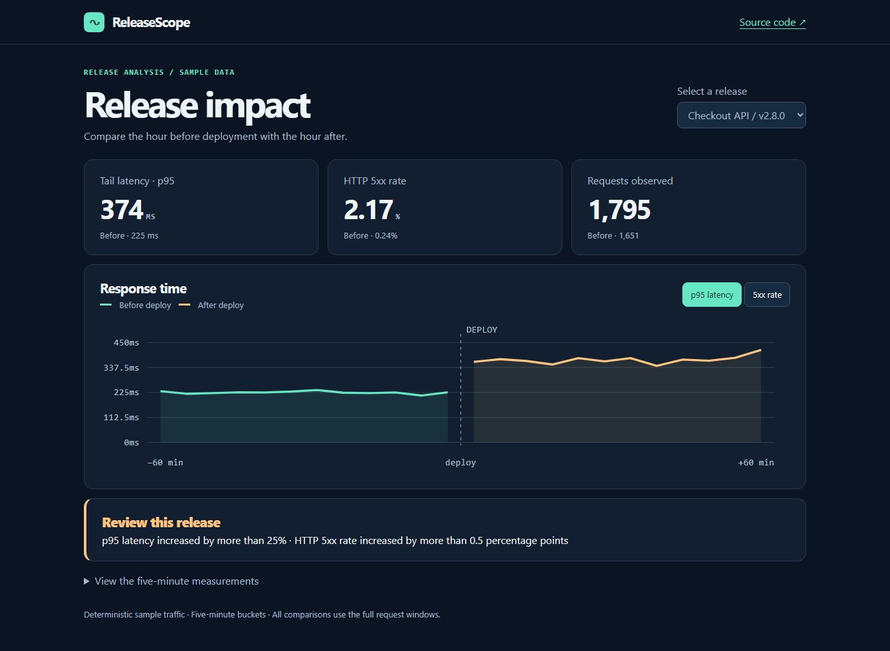

# ReleaseScope

**Did the last deployment make the service slower?** ReleaseScope compares request latency and HTTP server errors across two traffic windows. It pairs a Python analysis engine and FastAPI endpoint with an interactive release dashboard.

[Open the interactive demo](https://mohamadmirzaei79.github.io/ReleaseScope/) · [Explore the analysis](analysis_core.py) · [Read the tests](test_analysis.py)



### Try a release review

Select **Checkout API / v2.8.0**. Its p95 rises from 225 ms to 374 ms. Switch to **5xx rate** to see the second signal behind the review verdict. Then select **Search API** to compare a healthy release. Expand the measurements below the chart to inspect individual five-minute buckets.

### Engineering decisions

- **Compute from individual requests.** The engine sorts raw latencies and takes the nearest-rank 95th percentile across each entire window. The chart groups traffic into five-minute buckets for display.
- **Keep the verdict explainable.** A release needs review if p95 grows by more than 25% or the 5xx rate rises by more than 0.5 percentage points. The result includes every triggered rule. These thresholds flag a change for investigation and do not establish its cause.
- **Share one calculation across delivery modes.** The local API accepts custom observations. GitHub Pages serves a seeded, reproducible export of three synthetic releases. Both use the same Python functions. The browser has no external JavaScript or chart dependencies.

### Run locally

Requires Python 3.10+.

```sh
python -m pip install -r requirements.txt
python -m uvicorn app:app --port 8000
```

Open `http://localhost:8000` for the dashboard or `http://localhost:8000/docs` for the interactive API.

```sh
docker build -t releasescope .
docker run --rm -p 8000:8000 releasescope
```

### Analyze your own observations

Send two non-empty windows to `POST /api/compare`. Each accepts up to 50,000 HTTP observations with a latency in milliseconds and an HTTP status code. HTTP 500–599 counts as a server error.

```json
{
  "before": [{"latency_ms": 100, "status": 200}],
  "after": [{"latency_ms": 135, "status": 503}]
}
```

This minimal example triggers both review rules. For meaningful comparisons, use windows with comparable traffic volume and request mix.

### Reproduce and test

```sh
python build_demo.py
python -m unittest -v
```

Tests cover percentile selection, HTTP error classification, boundary values, invalid inputs, and consistency between the generated fixture and the static demo.
